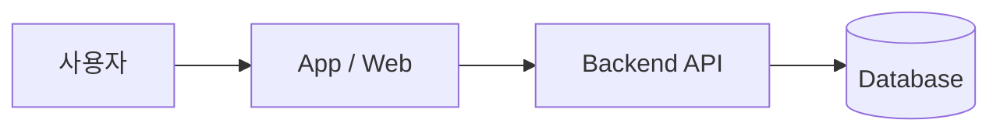

# 🍽️ 우연한 식탁 MVP

> **2026 우연한식탁 MVP 개발 해커톤** (주최: 어치브모먼트 · Blaybus) 참가 저장소
> 실제 소셜다이닝 서비스 **우연한 식탁**의 운영 문제를 해결하는 앱 MVP를 7일 동안 구현합니다.

<!-- 배포 후 채우기 -->
**🔗 Demo:** _TBD_ &nbsp;|&nbsp; **📹 시연 영상:** _TBD_

---

## 📅 일정

| 단계 | 기간 |
|---|---|
| 온라인 킥오프 | 2026.10.14 (수) 20:00 |
| MVP 개발 | 2026.10.15 (목) ~ 10.21 (수) |
| 수상자 발표 | 2026.10.29 (목) |

---

## 🎯 문제 정의

<!-- 킥오프에서 공개되는 운영 문제/요구사항을 바탕으로 작성 -->

- **대상 사용자:** _TBD_
- **해결하려는 운영 문제:** _TBD_
- **핵심 가설:** _TBD_

## 💡 솔루션 개요

_TBD — 한두 문장으로 MVP가 무엇을 하는지 요약_

---

## ✅ 요구사항 & 구현 현황

<!-- 주최 측 요구사항 정의서 항목을 그대로 옮겨 체크리스트로 관리 -->

| # | 요구사항 | 우선순위 | 상태 |
|---|---|---|---|
| R1 | _TBD_ | Must | ⬜ |
| R2 | _TBD_ | Must | ⬜ |
| R3 | _TBD_ | Should | ⬜ |

> 상태: ⬜ 미착수 · 🟨 진행 중 · ✅ 완료

---

## 🛠 기술 스택

| 영역 | 사용 기술 |
|---|---|
| Frontend / App | _TBD_ |
| Backend / DB | _TBD_ |
| AI | _TBD_ |
| Deploy | _TBD_ |

## 🏗 아키텍처

<!-- 다이어그램 이미지 또는 mermaid -->



---

## 📁 디렉토리 구조

```
.
├── README.md
└── ...  # TBD
```

## 🚀 실행 방법

```bash
# 1. 저장소 클론
git clone https://github.com/Chaewon-Park-STUDY/Uyeonhan-MVP-Hackathon.git
cd Uyeonhan-MVP-Hackathon

# 2. 환경 변수 설정
cp .env.example .env   # 필요한 키 입력

# 3. 설치 및 실행
# TBD
```

---

## 🤖 AI 활용 내역

<!-- 해커톤 취지상 AI 활용 방식을 투명하게 기록 -->

| 용도 | 도구 | 설명 |
|---|---|---|
| 코드 생성/리뷰 | _TBD_ | _TBD_ |

## 📝 개발 로그

| 날짜 | 작업 내용 |
|---|---|
| 10.15 | _TBD_ |
| 10.16 | _TBD_ |
| 10.17 | _TBD_ |
| 10.18 | _TBD_ |
| 10.19 | _TBD_ |
| 10.20 | _TBD_ |
| 10.21 | 최종 제출 |

---

## 👤 Team

| 이름 | 역할 | GitHub |
|---|---|---|
| 박채원 | _TBD_ | [@Chaewon-Park-STUDY](https://github.com/Chaewon-Park-STUDY) |
