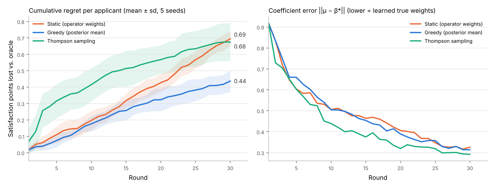

# Thompson Sampling 시뮬레이션 보고서 (W5-4)

작성: 2026-10-20 · 코드: `scripts/sim_thompson.py` · 원자료: `sim_thompson.json` · 그림: `sim_thompson.png`

## 1. 질문

피드백(테이블 만족도)으로 매칭 가중치를 학습할 때, 어떤 정책이 참가자 만족도를 가장 빨리 끌어올리는가?

| 정책 | 매칭에 쓰는 계수 | 성격 |
|---|---|---|
| STATIC | 운영자 가중치(사전평균) 고정 | 학습 없음 |
| GREEDY | 사후평균 β̂ | 활용만 |
| THOMPSON | 사후표본 β̃ ~ p(β \| data) | 탐색 + 활용 |

세 정책 모두 **확정 판단은 사후평균으로** 한다(DESIGN 4.6). 탐색용 표본으로 테이블을 확정하지 않는다.

## 2. 설정

- 가상 참가자 300명, 매 회차 120명 신청, 지역 3곳 × 최대 8테이블, 30회차, 시드 5개
- 참값 β\* = (절편 2.6; 성비 0.35, MBTI 0.15, 관심사 1.10, 원하는 사람 0.70, 새로운 만남 0.30)
  - 운영자 가중치를 1~5점 척도로 옮긴 사전평균은 (3; 0.6, 0.5, 0.4, 0.3, 0.2)
  - 즉 **"실제로는 관심사·원하는 사람이 더 중요한데 운영자는 성비·MBTI를 더 중시했다"**는 상황
- 테이블 만족도 y = β\*₀ + β\*ᵀφ + ε, ε ~ N(0, 0.35²)
- 같은 테이블에 앉았던 쌍은 이후 novelty가 떨어짐 → 회차가 지날수록 상태가 변함
- regret = (β\*로 매칭했을 때의 기대 만족도 합 − 정책 매칭의 기대 만족도 합) / 신청자 수

## 3. 결과

| 정책 | 누적 regret (30회) | 1~10회 회차당 regret | 21~30회 회차당 regret | 계수 오차 1회→30회 |
|---|---|---|---|---|
| STATIC | 0.694 ± 0.044 | 0.020 | **0.027 (악화)** | — (학습 안 함) |
| GREEDY | **0.437 ± 0.067** | 0.018 | 0.011 | 0.92 → 0.31 |
| THOMPSON | 0.675 ± 0.116 | 0.042 | **0.011 (최저)** | 0.92 → **0.29** |

매칭률은 세 정책 모두 100%(필수 조건 위반 0).

## 4. 해석

1. **학습은 확실히 효과가 있다.** 21~30회차의 회차당 손실이 STATIC 대비 약 60% 줄었다(0.027 → 0.011). 운영자 가중치를 고정하면 오히려 시간이 갈수록 손실이 커진다. 반복 참가로 "새로운 만남" 조건이 빡빡해지는데, 잘못된 가중치로는 이를 보완하지 못하기 때문이다.
2. **30회차 범위에서는 GREEDY가 누적 손실이 가장 작다.** 매칭 엔진의 지역탐색이 매 회차 다양한 φ 조합을 만들어 내서, 일부러 탐색하지 않아도 계수를 배울 만큼의 다양성이 자연스럽게 생긴다.
3. **THOMPSON은 초반 탐색 비용을 치르고, 그만큼 더 빨리·정확히 배운다.** 계수 오차가 가장 빨리 줄고, 후반 회차당 손실은 가장 낮다. 다만 30회차 안에서는 초반 손실을 다 만회하지 못한다.

## 5. 결정

- **운영 기본 정책은 `mean`(GREEDY)으로 유지한다** (`settings.matching.policy = "mean"`).
  첫 달은 참가자 경험이 가장 중요하므로, 탐색으로 만족도를 깎는 위험을 피한다.
- **THOMPSON은 운영자가 켤 수 있는 옵션으로 둔다** (`policy = "thompson"`). 다음 경우에 켠다.
  - 신청자 구성이 비슷해서 φ의 다양성이 부족할 때(같은 사람들이 반복 참가)
  - 새로운 특성(예: 동물 카드)을 추가해서 그 계수를 빨리 배워야 할 때
- 데이터가 쌓이면(테이블 수 ≥ 100) 실제 피드백으로 같은 비교를 다시 한다.

## 6. 한계

- 만족도 모형이 선형이라고 가정했다. 실제로는 상호작용(예: 성비 × MBTI)이 있을 수 있다.
- 참값 β\*는 가정이다. 운영자 가중치가 맞는 상황에서는 STATIC도 충분히 좋다.
- 참가자 이탈·재참가 확률이 만족도에 따라 달라지는 효과는 넣지 않았다.
